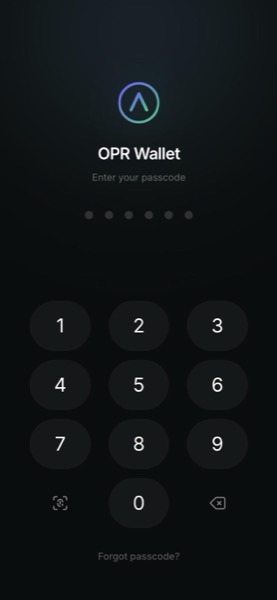
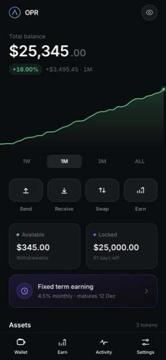
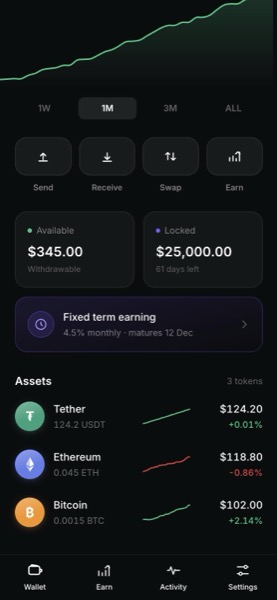
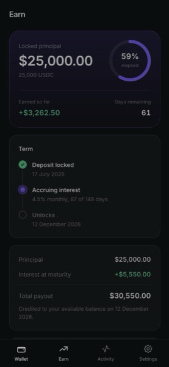
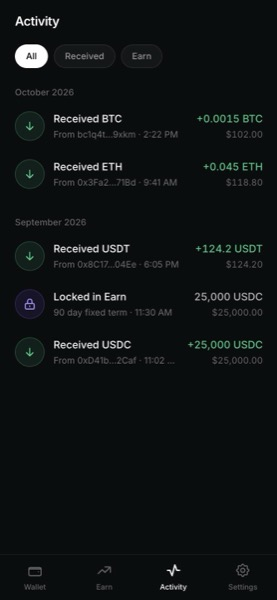
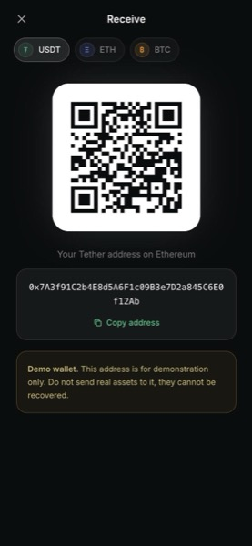

# OPR Wallet

A dark, mobile-first interface for a multi-chain crypto wallet. Built as a design and
front-end exercise: a self-custody wallet with spot holdings, a fixed term earning
position, transaction history, and send/receive flows.

**React 19 + Vite + TypeScript + Tailwind.** No chart library, no component library.
Every graph, ring and icon in the app is hand-built SVG.

> Demo project. No keys are generated, no funds are held, and outgoing transfers are
> intentionally disabled.

| Lock | Wallet | Assets | Earn | Activity | Receive |
|---|---|---|---|---|---|
|  |  |  |  |  |  |

## Design direction

The reference points were current crypto wallet patterns rather than banking apps:
a headline balance with de-emphasised cents, a pill row of primary actions, and asset
rows carrying their own sparkline so the list doubles as a market view.

The palette is deliberately narrow. A near-black base (`#0B0C0F`) with translucent
white surfaces does the structural work, so colour only ever means something:

| Token | Use |
|---|---|
| `#16C784` | Gains, confirmed inflows |
| `#EA3943` | Losses |
| `#7C5CFF` | Locked capital and the Earn term |
| White | The single primary action on any screen |

Numbers are set in tabular figures throughout so columns stay aligned and digits do
not jitter as values animate.

## Things worth looking at

**Charting, from scratch.** The portfolio graph fits a Catmull-Rom spline through the
series and converts it to cubic béziers, which gives a curve that reads like a market
line instead of a polyline. It measures its own container and matches the SVG viewBox
to real pixel width, so the end marker stays a circle rather than being stretched by a
non-uniform scale. The same primitive drives the per-token sparklines and the Earn
progress ring. See [`components/Charts.tsx`](components/Charts.tsx).

**The QR code is real.** Receive encodes the actual address through a proper QR
encoder, so it scans. It renders as crisp SVG rects rather than a raster image, which
keeps it sharp at any size. See [`components/Receive.tsx`](components/Receive.tsx).

**Derived state, not hardcoded strings.** The Earn position is defined only by its
principal, rate, start and maturity dates. Everything on screen is computed from those:
days elapsed, percentage of term served, interest accrued to date, and the maturity
payout. The figures move on their own as time passes.

**Interface details.** A six digit passcode lock with a shake on failure and a Face ID shortcut, a balance count-up that
still lands correctly if the tab is backgrounded and `requestAnimationFrame` is
throttled, bottom sheets with spring easing, and a 15 minute inactivity auto-lock.

## Demo state

- **$345.00** spot across USDT, ETH and BTC
- **25,000 USDC** locked in a fixed term position at **4.5% monthly**, opened
  17 July 2026 and maturing 12 December 2026, paying out **$30,550.00**

Passcode: `110801`, or tap the Face ID key to unlock.

## Run it

```bash
npm install
npm run dev
```

Then open http://localhost:3000.

## Build

```bash
npm run build    # static site in ./dist
npm run preview
```

Deploys to any static host with no configuration and no environment variables.
Build command `npm run build`, output directory `dist`.

## Structure

```
App.tsx              shell, routing, inactivity lock
data.ts              holdings, Earn position, transactions, seeded price series
utils.ts             currency, date and interest helpers
components/
  Charts.tsx         AreaChart, Sparkline, ProgressRing
  Wallet.tsx         balance, chart, actions, asset list
  Earn.tsx           fixed term position and payout schedule
  Activity.tsx       grouped transaction history
  Send.tsx           amount keypad and asset picker
  Receive.tsx        QR and address
  Lock.tsx           passcode entry
  Ui.tsx             logo, coin icons, bottom sheet, count-up hook
```

Installable as a PWA, with its own icons, manifest and a network-first service worker.
